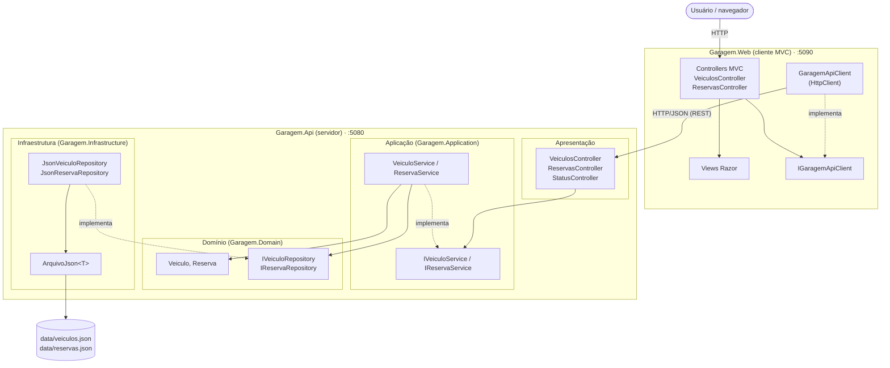
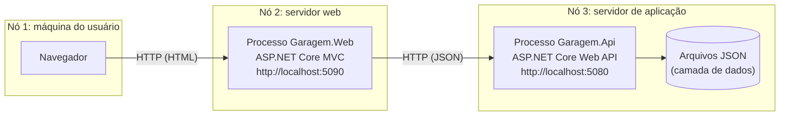
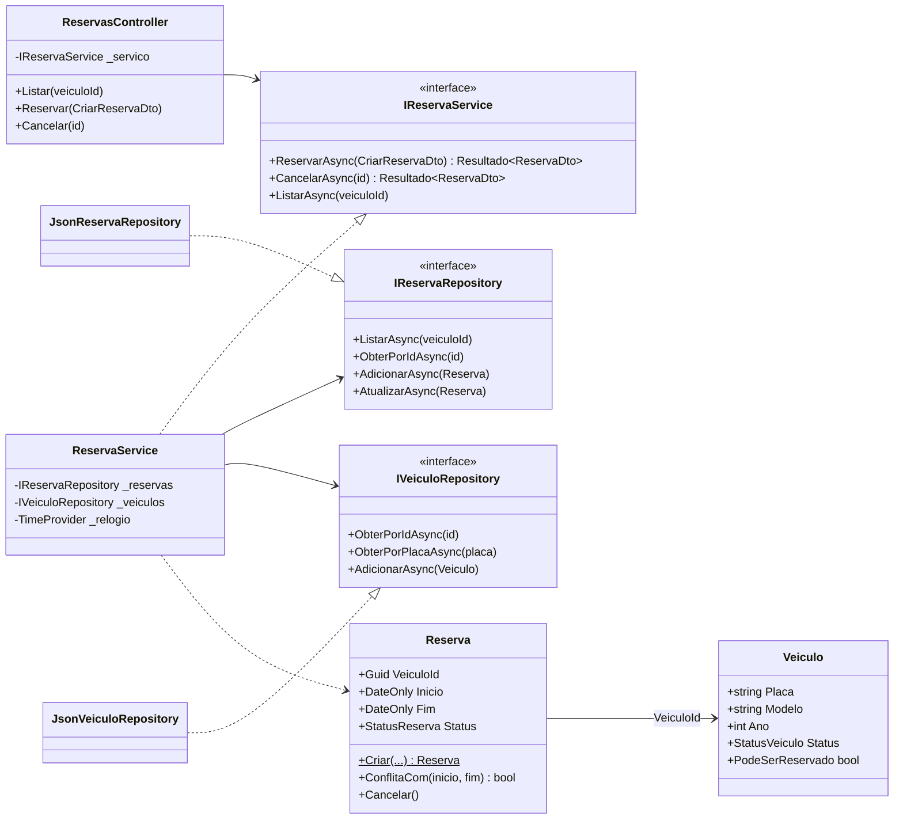
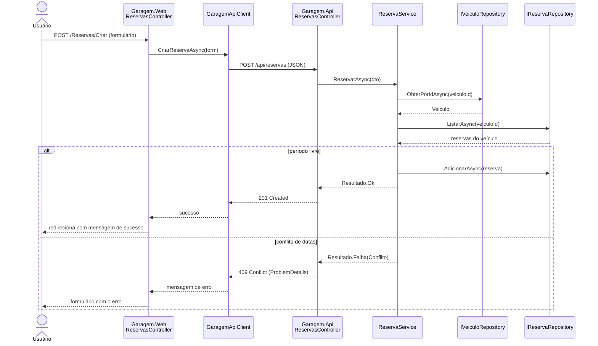
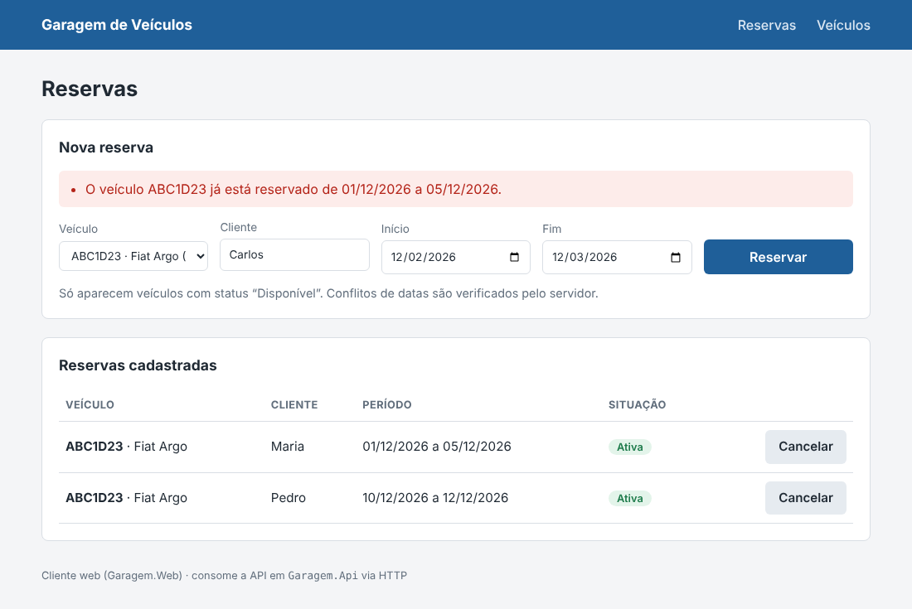
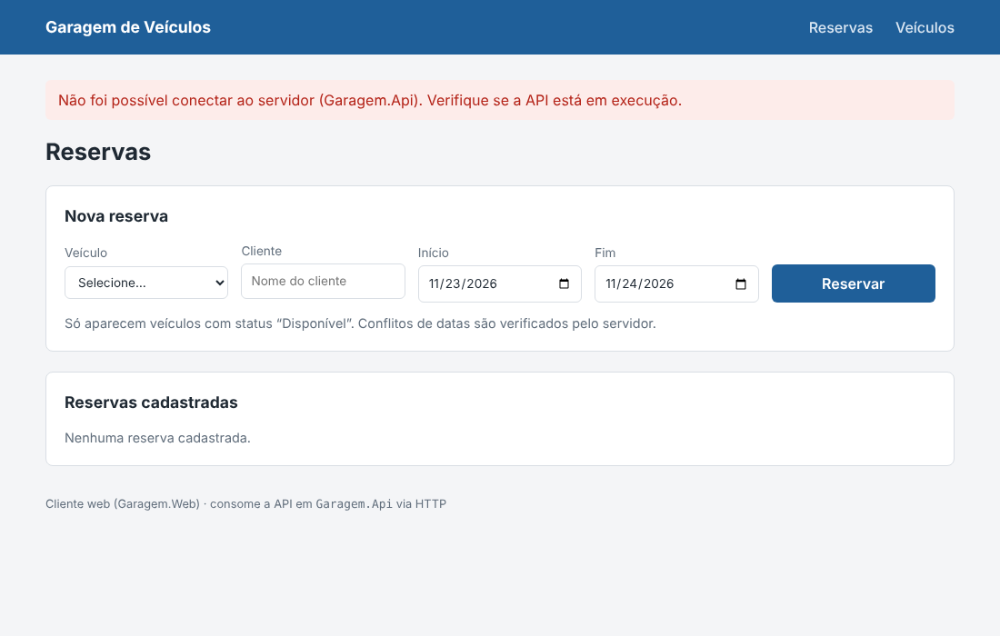
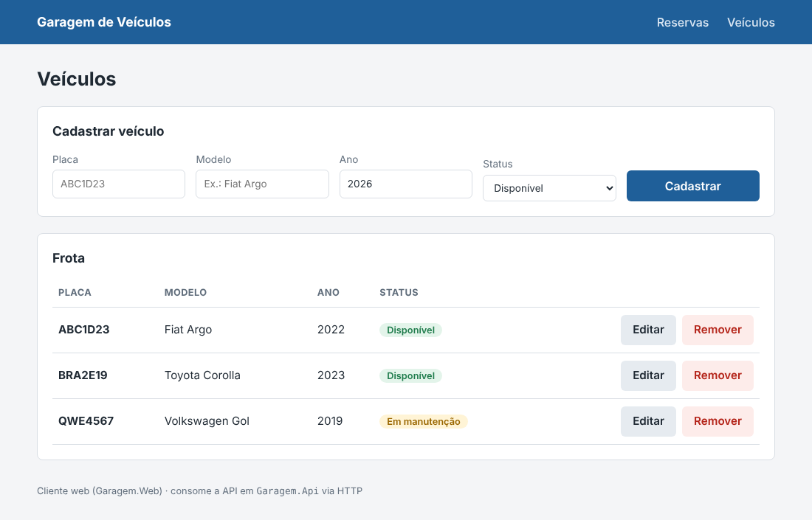

**Integrantes:** Gustavo Lopes Queiroz · João Henrique Porfirio Firmiano · Joao Victor Sevirino · Pedro Marques Moura · Thallys Heduardo Borba Marques

# Garagem de Veículos: cliente-servidor em N camadas

Trabalho N3, parte técnica · Arquitetura de Software (ESW430) · UniRV
Professor: Esp. Elielton de Souza Silva Monteiro
Tema 5: **Estilo cliente-servidor e arquiteturas em N camadas**

## Objetivo

Aplicar o estilo cliente-servidor e a organização em N camadas a um sistema de gestão de garagem de veículos, conforme a proposta descrita na parte teórica (seções 3 e 6). O sistema permite cadastrar veículos, consultar a frota, reservar um veículo para um período e cancelar reservas, impedindo reservas com datas sobrepostas.

O entregável mínimo do tema é atendido assim:

| Exigência do enunciado | Onde está |
|---|---|
| Cliente e servidor em projetos distintos | `src/Garagem.Web` (cliente) e `src/Garagem.Api` (servidor) |
| Comunicação entre eles | HTTP/JSON (API REST) |
| Camada de serviço | `src/Garagem.Application/Servicos` |
| MVC | Controllers e Views Razor no cliente; controllers na API |
| Repository | Interfaces em `Garagem.Domain`, implementações em `Garagem.Infrastructure` |
| Injeção de dependência | Contêiner do ASP.NET Core (`Program.cs` dos dois projetos) |
| Diagramas | Seção [Diagramas](#diagramas) |

## Arquitetura adotada

### Projetos (camadas lógicas)

| Projeto | Papel | Depende de |
|---|---|---|
| `Garagem.Web` | **Cliente**: interface web ASP.NET Core MVC. Não acessa dados; envia requisições HTTP à API. | nenhum projeto do servidor |
| `Garagem.Api` | **Servidor, camada de apresentação**: controllers REST e raiz de composição (registro da DI). | Application, Infrastructure |
| `Garagem.Application` | **Camada de aplicação (serviços)**: casos de uso `VeiculoService` e `ReservaService`, DTOs e `Resultado`. | Domain |
| `Garagem.Domain` | **Camada de domínio**: entidades `Veiculo` e `Reserva`, regras e contratos `IVeiculoRepository` e `IReservaRepository`. | nenhum |
| `Garagem.Infrastructure` | **Camada de dados**: repositórios que gravam em arquivos JSON. | Domain |
| `tests/Garagem.Tests` | Testes unitários dos serviços com repositórios falsos. | Application, Domain |

### Regras de dependência

- O cliente conhece apenas o **contrato HTTP** da API. O `Garagem.Web.csproj` não referencia nenhum projeto do servidor.
- Cada camada do servidor chama só a camada abaixo dela: controller → serviço → repositório.
- O domínio não depende de ninguém. A infraestrutura implementa as interfaces que o domínio define (**inversão de dependência**). Por isso a seta de dependência de `Infrastructure` aponta para `Domain`, ao contrário do sentido da chamada.
- Os controllers não têm regra de negócio nem acesso a dados. A regra de conflito de datas fica em `Reserva.ConflitaCom` (domínio) e é aplicada por `ReservaService` (aplicação).
- Entidades de domínio não saem do servidor: a API devolve DTOs, e a infraestrutura grava modelos de persistência próprios (`VeiculoRegistro`, `ReservaRegistro`).

### Camadas lógicas e níveis físicos

Como discutido na seção 2.3 da parte teórica, *layers* (camadas lógicas) e *tiers* (níveis físicos) são conceitos diferentes. Neste projeto há **cinco camadas lógicas** distribuídas em **três níveis físicos**: o processo do cliente web (porta 5090), o processo da API (porta 5080) e o armazenamento em arquivo. Os dois processos podem rodar em máquinas diferentes alterando apenas `Api:UrlBase` no `appsettings.json` do cliente.

### Tratamento de erros por camada (seção 3.2 da parte teórica)

| Situação | Camada que decide | Resposta da API | O que o cliente mostra |
|---|---|---|---|
| Placa inválida, data final antes da inicial | Domínio | `400 Bad Request` | Mensagem no formulário |
| Veículo ou reserva inexistente | Aplicação | `404 Not Found` | Mensagem no topo da tela |
| Período já reservado, placa duplicada, veículo em manutenção | Aplicação | `409 Conflict` | Mensagem no formulário |
| API fora do ar | Cliente (`GaragemApiClient`) | não há resposta | "Não foi possível conectar ao servidor" |

Os erros saem no formato padrão `ProblemDetails` (RFC 9110), sem expor detalhes internos.

### Concorrência

Duas requisições simultâneas podem tentar reservar o mesmo veículo. `ReservaService` executa "verificar conflito + gravar" dentro de um `SemaphoreSlim`, e `ArquivoJson<T>` serializa o acesso ao arquivo. O teste `Requisicoes_simultaneas_nao_geram_reserva_duplicada` dispara 20 reservas em paralelo e confirma que só uma é gravada.

Limitação: essa trava vale para **uma instância** da API. Com várias instâncias, a proteção precisaria ir para o banco de dados (restrição única ou transação), o que só exige uma nova implementação dos repositórios.

### Relação com MVC, Repository, SOLID e injeção de dependência

- **MVC:** no cliente, `VeiculosController` e `ReservasController` montam ViewModels e escolhem Views Razor. Na API, os controllers fazem o papel de entrada e saída (sem View).
- **Repository:** `IVeiculoRepository` e `IReservaRepository` isolam a persistência. Trocar JSON por SQL Server ou SQLite (via EF Core) exige mudar só `Garagem.Infrastructure` e o registro no `Program.cs` da API.
- **SOLID:**
  - **S**: controller traduz HTTP, serviço coordena o caso de uso, entidade valida a si mesma, repositório persiste.
  - **O/L**: novas implementações de repositório podem substituir as atuais sem alterar os serviços (os testes fazem isso com `VeiculoRepositoryFalso`).
  - **I**: interfaces pequenas e separadas por agregado.
  - **D**: serviços dependem de interfaces e de `TimeProvider`, nunca de classes concretas.
- **Injeção de dependência:** todas as dependências chegam pelo construtor. No servidor, o `Program.cs` liga interfaces a implementações. No cliente, `AddHttpClient<IGaragemApiClient, GaragemApiClient>` injeta o cliente HTTP nos controllers.

## Diagramas

### Diagrama de componentes



### Diagrama de implantação



Na demonstração os três nós são a mesma máquina, rodando dois processos independentes. A separação física é feita apenas por configuração (`Api:UrlBase`).

### Diagrama de classes (núcleo do servidor)



### Sequência: reservar veículo (seção 6.3 da parte teórica)



## Como executar

### Pré-requisito

- [.NET SDK 8](https://dotnet.microsoft.com/download) ou mais recente (9 ou 10 também funcionam). Verifique com `dotnet --version`.
- Conexão com a internet na primeira execução, para o `dotnet` baixar os pacotes de teste (xUnit).

### Passos

1. Clone o repositório e entre na pasta:

   ```sh
   git clone https://github.com/joaohpf/--garagem-cliente-servidor.git garagem-cliente-servidor
   cd garagem-cliente-servidor
   ```

2. (Opcional) Rode os testes:

   ```sh
   dotnet test
   ```

3. **Terminal 1, servidor:** inicie a API.

   ```sh
   dotnet run --project src/Garagem.Api
   ```

   Aguarde a mensagem `Now listening on: http://localhost:5080`. Para conferir, abra http://localhost:5080/api/status.

4. **Terminal 2, cliente:** inicie a interface web.

   ```sh
   dotnet run --project src/Garagem.Web
   ```

5. Abra http://localhost:5090 no navegador.

Na primeira execução a API cria três veículos de exemplo em `src/Garagem.Api/data/`. Para voltar ao estado inicial, pare a API e apague essa pasta.

### Roteiro de demonstração

1. Em **Veículos**, cadastre um veículo (ex.: placa `RVD2A26`). Tente cadastrar a mesma placa de novo: o servidor responde 409 e o cliente mostra a mensagem.
2. Em **Reservas**, reserve o Fiat Argo de 01/12 a 05/12.
3. Tente reservar o mesmo veículo de 05/12 a 07/12: a reserva é recusada por conflito (a data final conta).
4. Cancele a primeira reserva e repita o passo 3: agora é aceita.
5. Pare a API (Ctrl+C no terminal 1) e recarregue o cliente: aparece o aviso de servidor indisponível, e o cliente continua no ar.
6. Opcional: teste a API direto com o arquivo `src/Garagem.Api/Garagem.Api.http` (VS Code com a extensão REST Client, Visual Studio ou Rider) ou com `curl`:

   ```sh
   curl http://localhost:5080/api/veiculos
   ```

### Endpoints da API

| Método | Rota | Descrição | Respostas |
|---|---|---|---|
| GET | `/api/status` | Verifica se o servidor está no ar | 200 |
| GET | `/api/veiculos` | Lista veículos | 200 |
| GET | `/api/veiculos/{id}` | Obtém um veículo | 200, 404 |
| POST | `/api/veiculos` | Cadastra veículo | 201, 400, 409 |
| PUT | `/api/veiculos/{id}` | Altera veículo | 200, 400, 404, 409 |
| DELETE | `/api/veiculos/{id}` | Remove veículo sem reservas ativas | 204, 404, 409 |
| GET | `/api/reservas?veiculoId=` | Lista reservas (filtro opcional) | 200 |
| GET | `/api/reservas/{id}` | Obtém uma reserva | 200, 404 |
| POST | `/api/reservas` | Cria reserva | 201, 400, 404, 409 |
| PATCH | `/api/reservas/{id}/cancelar` | Cancela reserva | 200, 404, 409 |

## Telas

| Reserva recusada por conflito | Servidor fora do ar |
|---|---|
|  |  |



## Testes

`tests/Garagem.Tests` (xUnit) testa os serviços sem API, sem rede e sem arquivo, usando repositórios falsos e um relógio fixo injetados pelo construtor. São 19 casos, entre eles:

- reserva com período conflitante é rejeitada, inclusive quando o novo período começa no último dia do anterior;
- períodos vizinhos sem sobreposição são aceitos;
- reserva cancelada libera o período;
- veículo em manutenção não pode ser reservado;
- 20 requisições simultâneas geram apenas uma reserva;
- placa duplicada, dados inválidos e remoção de veículo com reserva ativa.

## Estrutura de pastas

```
├── Garagem.sln
├── src/
│   ├── Garagem.Web/             # CLIENTE (MVC): Controllers, Views, Servicos/GaragemApiClient
│   ├── Garagem.Api/             # SERVIDOR: Controllers REST + Program.cs (DI)
│   ├── Garagem.Application/     # Serviços (casos de uso), DTOs, Resultado
│   ├── Garagem.Domain/          # Entidades, regras e interfaces de repositório
│   └── Garagem.Infrastructure/  # Repositórios JSON
├── tests/Garagem.Tests/         # Testes unitários (xUnit)
└── docs/                        # Capturas de tela
```

## Tecnologias

- C# 12, .NET 8, ASP.NET Core Web API e ASP.NET Core MVC (Razor)
- System.Text.Json para a persistência em arquivo
- xUnit para os testes
- Mermaid para os diagramas (renderizados pelo GitHub)

## Ferramentas de IA utilizadas

- **Claude (Anthropic):** apoio na geração do código, dos testes, dos diagramas e deste README a partir da parte teórica do grupo. O código foi revisado e testado pelo grupo.
- **ChatGPT (OpenAI):** apoio na organização textual e nos diagramas da parte teórica (conforme a seção 8.3 do documento teórico).
